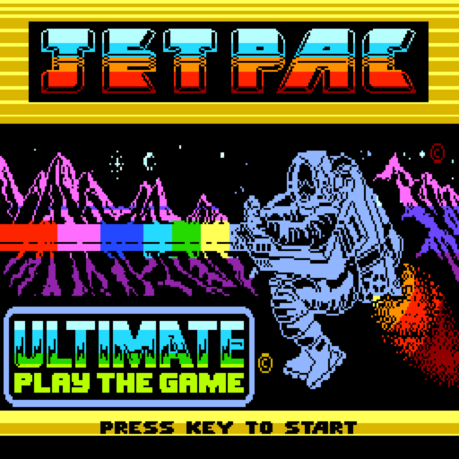
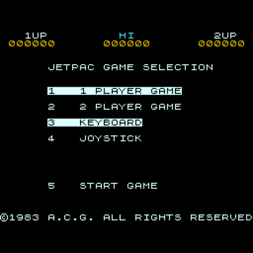
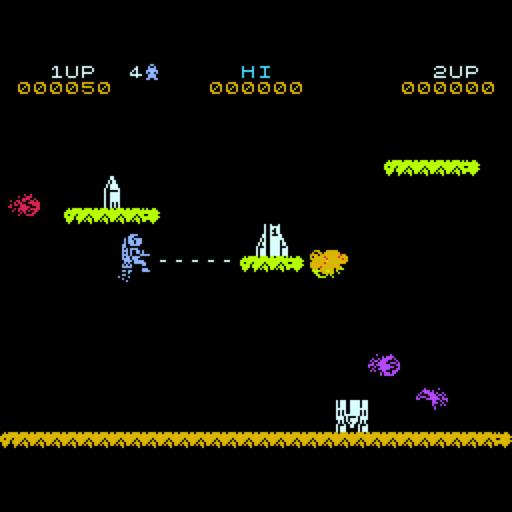
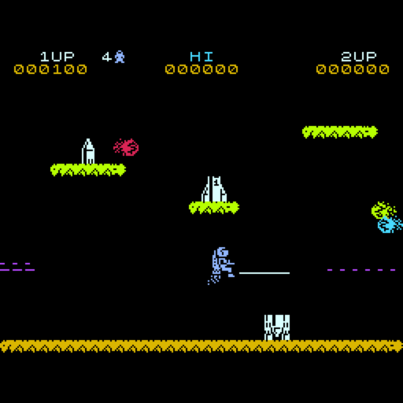
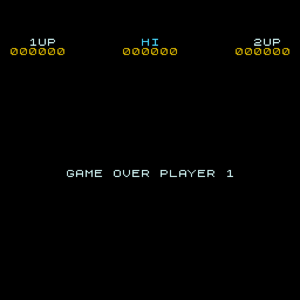

# Jetpac — порт на Вектор-06Ц

**Jetpac** (Ultimate Play the Game, 1983, ZX Spectrum 16K) на ванильном **Векторе-06Ц**:
i8080 3 МГц, 64 КБ, без Z80-переходника и без квазидиска. Код игры — картриджная версия ZX
(дизассемблер Майкла Кука), переведённая на i8080 через JS-модель; логика сверена с оригиналом
ZX проход в проход (8 сценариев, ~70 тысяч проходов главного цикла). Вывод, звук и ввод — свои,
под Вектор: цвет без «клэша» атрибутов, 16-цветная заставка, звук на ВИ53.

| Заставка | Меню |
|---|---|
|  |  |

| Игра | Игра | GAME OVER |
|---|---|---|
|  |  |  |

## Готовые образы

Образ памяти **с адреса 0x0000** (формат `.C00` / `.r0m`): на MiSTer (ядро Vector-06C) открывается
через меню ядра как `.C00`, в эмуляторах — как `.r0m`.

| Файл | Что это |
|---|---|
| [`rom/jetpac.c00`](rom/jetpac.c00) | для MiSTer: заставка, меню, игра |
| [`rom/jetpac.r0m`](rom/jetpac.r0m) | тот же образ для эмуляторов (Emu80, vector06js) |

## Управление

На заставке — любая клавиша. В меню: **1** / **2** — один или два игрока, **3** / **4** —
клавиатура или джойстик, **5** (или огонь) — старт.

| действие | клавиши |
|---|---|
| влево | ← или Z (как на ZX: также C, B, M) |
| вправо | → или X (также V, N) |
| газ (вверх) | ↑ или Q W E R T, Y U I O P |
| огонь | пробел или A S D F G, H J K L |
| висеть на месте | цифры 1…0 |
| пауза | ВК (нажать — пауза, ещё раз — дальше) |

**Джойстик «П»** работает всегда: в режиме «3 KEYBOARD» он сводится к клавишам выше, в режиме
«4 JOYSTICK» — к джойстику Interface 2 оригинала (клавиши 6…0).

**Бессмертие:** в меню нажать **F1+F3** вместо «5» — игра начнётся, пришельцы при касании
взрываются, Джетмен остаётся жив.

## Что по-другому, чем на ZX

- **Цвет без клэша.** На ZX цвет задаётся клеткой 8×8, и спрайты перекрашивают друг друга. Здесь
  каждый объект рисуется в своих плоскостях (Джетмен — своя плоскость), цвет попиксельный.
- **Палитра** — мягкая «векторовская»; цвета Джетмена, салатный и золотой взяты с заставки.
- **Заставка** — экран картриджа ZX, раскрашенный в 16 цветов и растянутый на все 256 строк.
- **Мелодия на старте игры** — из версии для BBC Micro (David Rhys Jones, 1983); в ZX-версии
  её нет. Разбор — [docs/BBC_TUNE.md](docs/BBC_TUNE.md).
- **Звук** — эффекты оригинала, пересчитанные с бипера ZX на ВИ53; игра их не ждёт.

## Сборка

Нужны Python 3 и [sjasmplus](https://github.com/z00m128/sjasmplus) (в `tools/sjasmplus` — сборка
под macOS arm64; на другой машине — свой в PATH). Дизассемблер подключён подмодулем:

```sh
git submodule update --init
python3 -m venv .venv && .venv/bin/pip install skoolkit   # skool -> бинарник ZX и таблица меток
tools/mkbin.sh                     # картриджная сборка ZX: build/jetpac.bin, build/z80.sym
tools/build_vec.sh                 # Вектор: build/vec/jetpac.bin, rom/jetpac.r0m, rom/jetpac.c00
```

Заставка пересобирается `python3 tools/mksplash.py` (нужен Pillow и `tools/zx0/zx0`:
`clang -O2 -o tools/zx0/zx0 tools/zx0/*.c`).

## Проверки

Стенды — на Node.js; ядро i8080 и эмулятор Вектора — [vector06js](https://github.com/svofski/vector06js)
(клон в `~/projects/vector06js` или путь в `V06JS`).

```sh
node tools/zx_trace.js research/scenarios/s1_bot.json        # эталон ZX -> build/golden/s1_bot.json.gz
node tools/model_run.js build/golden/*.json.gz               # JS-модель против ZX
node tools/lock80.js build/golden/s1_bot.json.gz [--prof]    # i8080 против ZX (+ профиль, темп)
node tools/vecshot.js rom/jetpac.r0m 700 "120:space+ 130:space-" out.png   # снимок экрана Вектора
tools/emu80_run.sh                                           # запуск в Emu80 с окном
```

Как устроен порт — [docs/LOGIC_PLAN.md](docs/LOGIC_PLAN.md), журнал —
[docs/JOURNAL.md](docs/JOURNAL.md).

## Откуда

Оригинал — Ultimate Play the Game (Ashby Computers & Graphics), 1983, Тим и Крис Стамперы.
Дизассемблер ZX — [Michael R. Cook](https://github.com/mrcook/jetpac-disassembly), собран
[SkoolKit](https://skoolkit.ca) Ричарда Даймонда. Мелодия старта — версия для BBC Micro,
David Rhys Jones. Z80.js — Molly Howell (MIT). Сжатие — ZX0 Эйнара Саукаса, распаковщик i8080 —
Иван Городецкий (ivagor). Порт на Вектор-06Ц — Борис Лихачёв, 2026.
